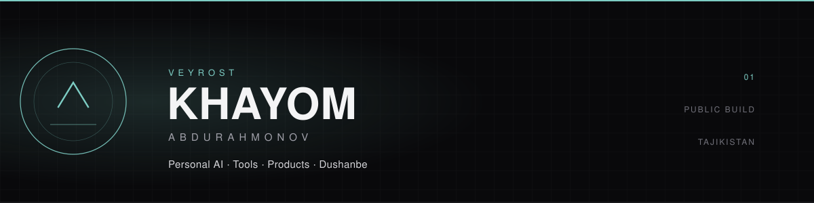

  
  
  
  
  
  

**KHAYOM ABDURAHMONOV** · Independent Developer · Dushanbe, Tajikistan 🇹🇯

*Engineering software. Exploring intelligence. Building useful technology.*

---

## /01 — Engineering profile

I am an independent developer working across **AI security, developer tooling, automation, backend systems, and practical web applications**. I build and experiment with software that aims to solve concrete problems—not just demonstrate technology.

My approach emphasizes understandable architecture, local-first workflows where practical, security-conscious implementation, testing, and honest documentation. I am particularly interested in making useful tools accessible to people working with limited hardware and resources.

### Main areas

- **AI & agent security** — AI skill auditing, prompt-injection detection, MCP integrations, local AI experiments.
- **Developer infrastructure** — repository analysis, quality checks, CLI tools, automation and diagnostics.
- **Backend engineering** — Node.js, APIs, PostgreSQL, Supabase, authentication and data models.
- **Web applications** — JavaScript, TypeScript, responsive interfaces, PWAs and offline-first workflows.
- **Mobile/Linux workflows** — Android, Termux, shell scripting and lightweight development environments.

## /02 — VEYROST ecosystem

# VEYROST

**An independent technology initiative founded by Khayom Abdurahmonov.**

A growing collection of experiments and tools around AI, software engineering, automation, and accessible technology.

VEYROST is an evolving ecosystem, not a claim that every planned capability is already complete. Its connected projects are documented according to their actual implementation and current status.

## /03 — Selected projects

<table>
<tr>
<td width="50%" valign="top">

### 🛡️ SkillGuard

**AI agent skill security scanner · JavaScript · Node.js**

Audits agent skill bundles for prompt injection, exposed secrets, hidden Unicode, dangerous execution patterns, persistence, and risky permissions.

- Scans skill instructions and supporting files
- Does not execute scanned scripts
- Offline operation; no API key
- Explainable findings and CI-oriented workflow

<a href="https://github.com/Khayom1/SkillGuard">SOURCE REPOSITORY →</a>

</td>
<td width="50%" valign="top">

### 🧰 VEYROST-DEVKIT

**Repository health & security toolkit · JavaScript**

A local-first utility for inspecting repository hygiene, selected secret patterns, project quality, and maintainability.

- Explainable project-health scoring
- Security and configuration checks
- Text, JSON, Markdown, HTML and SVG reports
- No external service required for local scans

<a href="https://github.com/Khayom1/VEYROST-DEVKIT">SOURCE REPOSITORY →</a>

</td>
</tr>
<tr>
<td width="50%" valign="top">

### 🤖 VEYROST

**Personal AI system · AI experiments · Automation**

The central repository for the VEYROST personal-AI initiative and its evolving architecture.

- Local-model experimentation
- Tool integration and agent workflows
- Context and memory architecture research
- Human–AI interaction experiments

Experimental system; capabilities evolve as components are implemented and validated.

<a href="https://github.com/Khayom1/Veyrost">SOURCE REPOSITORY →</a>

</td>
<td width="50%" valign="top">

### 📻 WAYLINE RADIO

**Multi-tenant internet-radio platform · Node.js · PostgreSQL**

A platform concept for trucking and logistics companies, with company-specific stations and a shared control plane.

- Company-aware data model and access checks
- Signed sessions and password hashing
- RSS/Atom ingestion and review workflow
- Rights-aware content approval controls

Active development; production streaming and licensed media providers need separate configuration.

<a href="https://github.com/Khayom1/WAYLINE-RADIO">SOURCE REPOSITORY →</a>

</td>
</tr>
<tr>
<td width="50%" valign="top">

### 🌐 NetScope

**Network troubleshooting · Python**

A privacy-first toolkit that checks DNS, TCP, HTTPS, ping, IPv6 and routes, then explains results and possible next steps.

- Android, Linux, macOS and Windows targets
- Tajik, Russian and English explanations
- CLI and mobile-friendly web interface
- JSON/TXT reports; no telemetry

<a href="https://github.com/Khayom1/NetScope">SOURCE REPOSITORY →</a>

</td>
<td width="50%" valign="top">

### 🔌 Telegram Channel Manager (MCP)

**Telegram automation · JavaScript · MCP**

A self-hosted MCP server that exposes selected Telegram channel-management actions to compatible AI clients.

- Channel information and member count
- Text and photo publishing tools
- Telegram Bot API integration
- Secret-based endpoint protection

Requires a configured bot, hosting, and securely managed secrets.

<a href="https://github.com/Khayom1/telegram-channel-mcp">SOURCE REPOSITORY →</a>

</td>
</tr>
<tr>
<td width="50%" valign="top">

### ✍️ Textivo

**Typography & motion-design web app · JavaScript**

A multilingual typography studio for creating styled text compositions with motion effects and export options.

<a href="https://github.com/Khayom1/textivo">SOURCE REPOSITORY →</a>

</td>
<td width="50%" valign="top">

### ⌨️ Layout Fixer

**Keyboard-layout correction · Python · Web**

A lightweight tool for correcting text typed with the wrong keyboard layout, with multilingual mappings and automated checks.

<a href="https://github.com/Khayom1/layout-fixer">SOURCE REPOSITORY →</a>

</td>
</tr>
<tr>
<td width="50%" valign="top">

### 💧 Chashma

**Three-language vocabulary game · JavaScript**

A fast word-and-translation game in Tajik, Russian, and English. Choose the correct translation before the spring overflows.

<a href="https://github.com/Khayom1/Chashma">SOURCE REPOSITORY →</a>

</td>
<td width="50%" valign="top">

### 🛒 Bozorcha

**Local marketplace project · Supabase · TypeScript**

A digital marketplace concept for buying and selling in Tajikistan, with product discovery, orders, user profiles, inventory workflows, and database-level access controls.

- [Core repository](https://github.com/Khayom1/bozorcha)
- [Seller interface](https://github.com/Khayom1/Bozorcha-taj)
- [App repository](https://github.com/Khayom1/bozorcha-app)

Related repositories in one product direction; inspect each for its current implementation.

</td>
</tr>
</table>

## /04 — Additional repositories & experiments

| Repository | Focus |
|---|---|
| [termux-toolkit](https://github.com/Khayom1/termux-toolkit) | Android Termux utilities, system information, network checks and Git helpers |
| [nektome-tj](https://github.com/Khayom1/nektome-tj) | Python project / experiment |
| [Scancam](https://github.com/Khayom1/Scancam) | Camera and scanning project repository |
| [VEYROST-Technology-Lab](https://github.com/Khayom1/VEYROST-Technology-Lab) | Long-term independent technology prototyping initiative |

Some repositories are prototypes or works in progress. Their presence here does not imply production readiness.

### Community and upstream repositories

I also keep a small number of forked repositories for reference or contribution workflows. Forks are not presented as original projects:

- [TemplatesWebsite](https://github.com/Khayom1/TemplatesWebsite)
- [product-taxonomy](https://github.com/Khayom1/product-taxonomy)
- [register](https://github.com/Khayom1/register)

## /05 — Technical toolkit

| Domain | Technologies |
|---|---|
| Languages | Python, JavaScript, TypeScript, Bash, HTML, CSS, SQL |
| Backend & data | Node.js, REST APIs, PostgreSQL, Supabase |
| Frontend | Responsive UI, PWAs, service workers, offline-first patterns |
| AI & integration | LLM experimentation, MCP, tool calling, agent workflows |
| Platforms | Android / Termux, Linux, browser applications, Docker |
| Engineering | Automated tests, validation, security checks, Git workflows |

## /06 — Engineering principles

- **Useful before impressive.** Solve a real problem and make the result understandable.
- **Evidence over assumptions.** Test behavior and document what is actually verified.
- **Privacy by design.** Avoid unnecessary data collection and external dependencies.
- **Architecture before shortcuts.** Build systems that can be maintained and extended.
- **Honest project status.** Make limitations, requirements, and unfinished work visible.
- **Accessible engineering.** Build within real-world constraints, not just ideal conditions.

## /07 — Join the team

### BUILD WITH VEYROST

**VEYROST is looking for motivated people who want to learn, contribute, and build.**

Areas of interest:

- Software and web development
- AI, LLMs, and automation
- UI/UX and visual design
- Testing, security, and documentation
- Research, product thinking, and community building

You do not need to be an expert. Consistency, responsibility, curiosity, and a willingness to learn matter.

## /08 — Collaboration

I welcome project ideas, bug reports, technical feedback, and collaboration proposals.

- Small tasks and learning projects: often free
- Open-source contributions: welcome
- Complex or time-intensive work: may be paid, with scope and terms agreed in advance

## /09 — GitHub activity

*Statistics are generated by external services and may be delayed or unavailable.*

## /10 — Connect

**Build deliberately. Learn continuously. Ship useful things.**

© Khayom Abdurahmonov · VEYROST Technology Lab · Tajikistan

